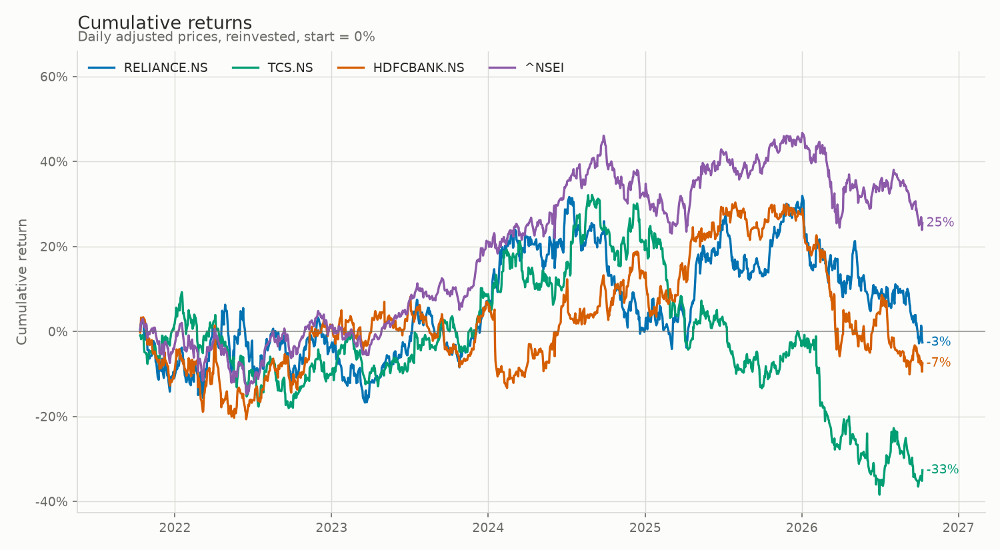
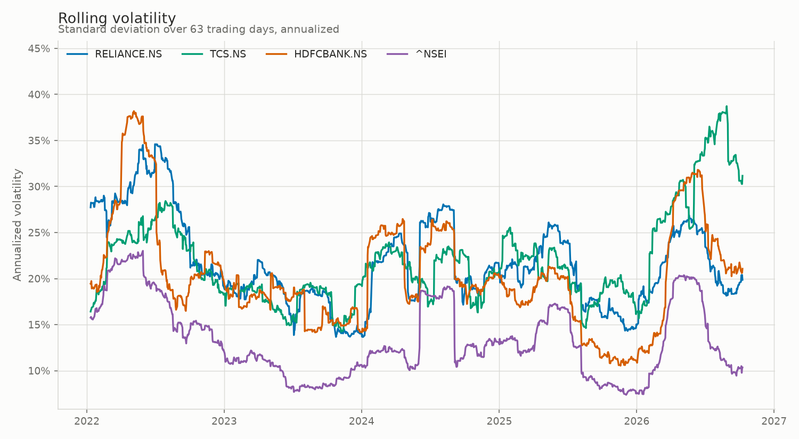
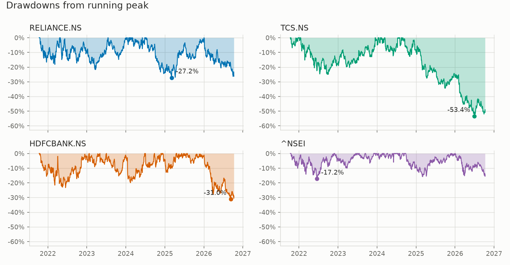
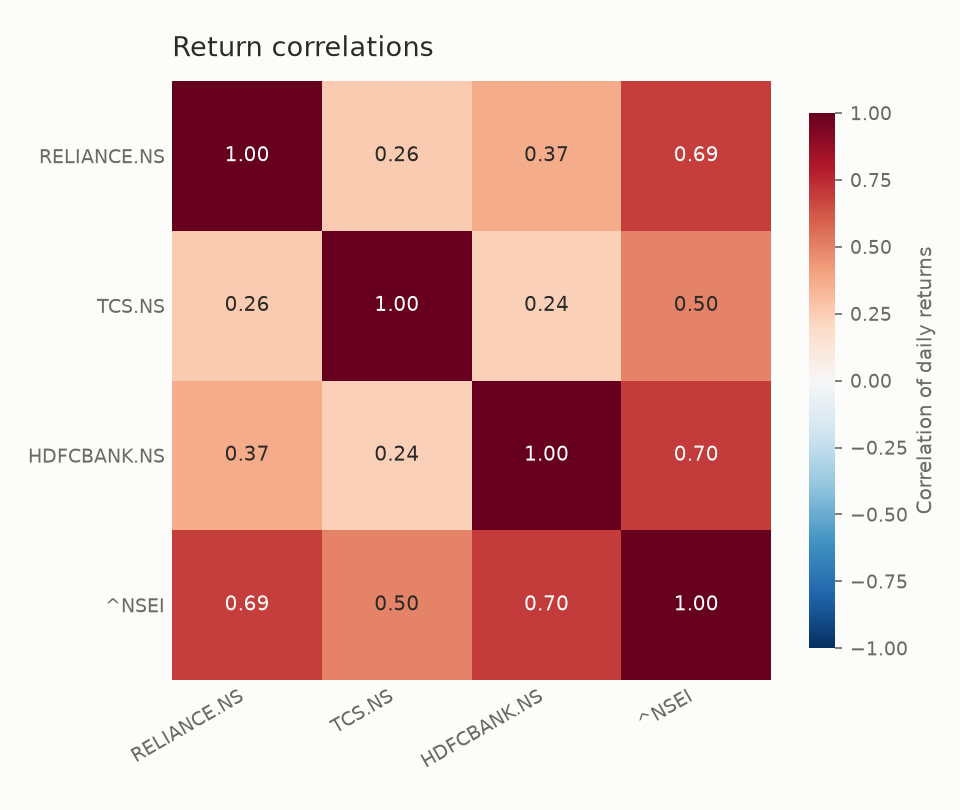
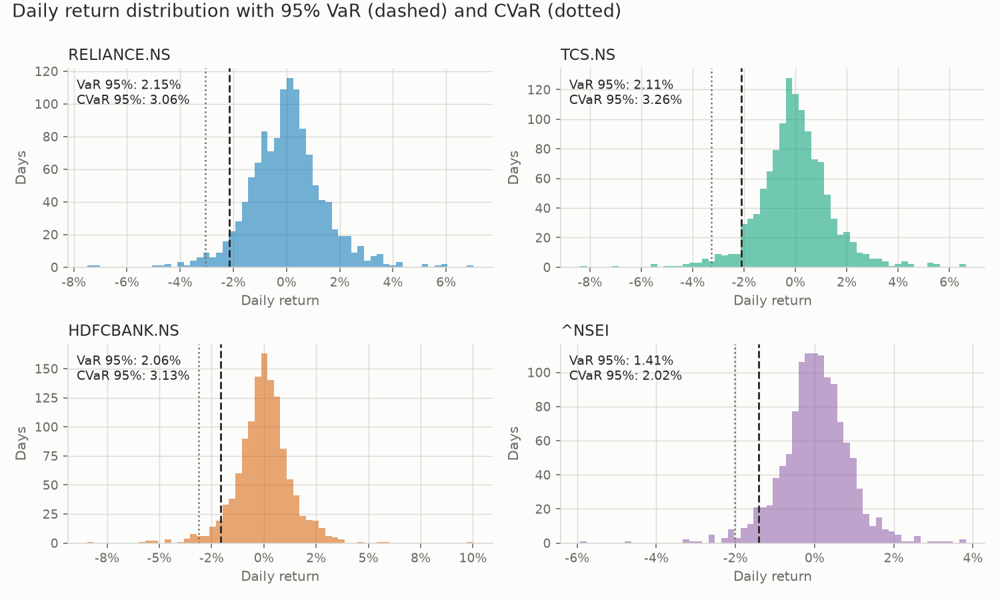

# Equity Risk Analytics

A small Python toolkit that measures the return and risk profile of three
large-cap NSE stocks against the NIFTY 50 index, using about five years of
daily adjusted prices.

## Objective

Given three stocks and a benchmark, answer four questions with numbers
rather than impressions:

1. **How much did each one return**, in total and per year?
2. **How risky was getting that return** - volatility, drawdown, and the
   size of a bad day?
3. **Was the return worth the risk** - Sharpe and Sortino?
4. **How much of each stock's movement is just the market** - beta, alpha
   and correlation against NIFTY 50?

The pipeline downloads the prices, cleans and aligns them, computes the
metrics, draws five charts, and writes a Markdown report from the numbers
it actually computed.

**Assets analysed:** RELIANCE.NS, TCS.NS, HDFCBANK.NS
**Benchmark:** ^NSEI (NIFTY 50)
**Period:** roughly the last 5 years of daily data, ending on the run date

## Setup

Requires Python 3.12.

```bash
git clone <this repository>
cd equity-risk-analytics

python3.12 -m venv .venv
source .venv/bin/activate          # Windows: .venv\Scripts\activate

pip install -r requirements.txt
```

## Usage

Run the whole pipeline:

```bash
python main.py
```

This prints a summary table to the terminal and writes:

```
outputs/
  risk_report.md                      the full report
  charts/
    cumulative_returns.png
    rolling_volatility.png
    drawdowns.png
    correlation_heatmap.png
    return_distributions.png
```

`outputs/` is gitignored, so the charts and report are regenerated on each
run rather than committed.

Run the tests:

```bash
python -m pytest tests -v
```

Change the tickers, the lookback window, the rolling window or the
risk-free rate in `src/equity_risk/config.py`.

### If the download fails

The pipeline needs an internet connection to reach Yahoo Finance. If the
download fails it says so explicitly, prints the reason, and falls back to
the small synthetic file in `data/sample/`. That file is **test data, not
market data**: it exists so the tests and the offline path have something
to run against. When the fallback is used, the report opens with a warning
saying the numbers are a code check and not real market risk.

## Project structure

```
equity-risk-analytics/
├── main.py                     runs the full pipeline
├── requirements.txt
├── src/equity_risk/
│   ├── config.py               all settings, including the risk-free rate
│   ├── data.py                 download, clean, align, validate
│   ├── returns.py              simple, log and cumulative returns
│   ├── metrics.py              volatility, drawdown, ratios, VaR, beta
│   ├── plots.py                the five charts
│   └── report.py               Markdown report builder
├── tests/
│   ├── test_returns.py
│   └── test_metrics.py
├── data/sample/                synthetic prices, used by the tests only
└── outputs/                    charts and report (gitignored)
```

## Methodology

**Prices.** Daily closes adjusted for splits and dividends, so that a
corporate action does not appear as an artificial jump in the return
series. Yahoo Finance supplies these through `yfinance` with
`auto_adjust=True`.

**Cleaning and alignment.** All tickers are put onto one shared calendar:
duplicate dates are dropped, days where every ticker is missing are removed
(market holidays), a gap in a single ticker is filled forward for up to
three days, and any day still incomplete is dropped. Every asset therefore
covers exactly the same set of trading days, which matters for beta and
correlation. Missing values are counted and reported before any of this
happens, and the cleaned frame is validated for emptiness, sort order,
duplicate dates, leftover gaps and non-positive prices.

**Returns.** Simple daily returns are used for the metrics. Log returns are
computed as well, since they add up across days.

**Annualization.** 252 trading days per year. Volatility is scaled by the
square root of 252; average returns are scaled by 252 itself.

**Sign conventions.** VaR and CVaR are reported as positive loss figures,
so 2.15% means a loss of 2.15%. Drawdowns stay negative, because a
drawdown reads more naturally as "down 27%".

### Formulas

Daily simple return, from price `P`:

```
r_t = P_t / P_(t-1) - 1
```

Daily log return:

```
l_t = ln(P_t / P_(t-1))
```

Cumulative return over the sample:

```
C_t = prod(1 + r_i, i = 1..t) - 1
```

Annualized return (CAGR), over `n` days:

```
CAGR = (prod(1 + r_t)) ^ (252 / n) - 1
```

Annualized volatility, with `sd` the sample standard deviation
(denominator `n - 1`):

```
sigma_annual = sd(r) * sqrt(252)
```

Rolling volatility, over a window of `w` days (default 63):

```
sigma_t = sd(r_(t-w+1) .. r_t) * sqrt(252)
```

Drawdown, from the wealth index `W_t = prod(1 + r_i)`:

```
DD_t = W_t / max(W_1 .. W_t) - 1
MaxDD = min(DD_t)
```

Daily risk-free rate, compounded down from the annual rate `R_f`:

```
rf_daily = (1 + R_f) ^ (1/252) - 1
```

Sharpe ratio, with excess return `e_t = r_t - rf_daily`:

```
Sharpe = mean(e) / sd(e) * sqrt(252)
```

Sortino ratio, where the downside deviation enters gains as zero rather
than dropping them:

```
DD_dev = sqrt( mean( min(e_t, 0) ^ 2 ) )
Sortino = mean(e) / DD_dev * sqrt(252)
```

Both ratios are built from the arithmetic mean of daily excess returns,
annualized by multiplying by 252 - not from the compound annual growth
rate. This means the sign of Sharpe or Sortino does not always match
whether CAGR is above or below the risk-free rate: in this project's own
results, NIFTY 50's CAGR (4.74%) is below the risk-free rate (5.57%) but
its Sharpe ratio is still slightly positive (+0.012), because daily
compounding pulls CAGR below the arithmetic mean return.

Historical VaR at 95%, reported as a positive loss:

```
VaR_95 = -quantile(r, 0.05)
```

Historical CVaR at 95% (expected shortfall), the average of the returns at
or below the VaR cutoff:

```
CVaR_95 = -mean( r_t : r_t <= quantile(r, 0.05) )
```

Beta against the market return `m`:

```
beta = cov(r, m) / var(m)
```

Annualized alpha, the CAPM leftover:

```
alpha = ( mean(r - rf_daily) - beta * mean(m - rf_daily) ) * 252
```

Correlation with the market:

```
rho = cov(r, m) / (sd(r) * sd(m))
```

## Assumptions

- **Risk-free rate of 5.57% per year.** `RISK_FREE_RATE` in
  `src/equity_risk/config.py` is sourced from the RBI 91-day T-bill
  auction result dated 7 Oct 2026 (cut-off yield 5.5747%, rounded). It is a
  single point-in-time yield applied to the whole 5-year window, so it is
  an approximation rather than a measured average over the period. Sharpe,
  Sortino and alpha all change when it does; total return, volatility,
  drawdown, VaR, CVaR, beta and correlation do not.
- The risk-free rate is held constant across the whole period, which it
  was not in reality.
- 252 trading days per year, applied uniformly to every year.
- Returns are treated as drawn from a single unchanging distribution,
  although volatility visibly moves around over time.
- No transaction costs, brokerage, taxes, slippage or market impact.
- Yahoo Finance adjusted closes are taken at face value, with no
  independent check against an exchange feed.
- Short gaps are filled forward for up to three days, which assumes a
  missing print means "no change" rather than "no trading".

## Limitations

- Five years of daily data is a short sample for tail risk. At 95%
  confidence the VaR rests on roughly the worst 60 days in the sample, so
  a handful of observations move it.
- Historical VaR cannot describe a loss larger than the worst day already
  in the sample, so it will understate a genuine crisis.
- Equity returns have fatter tails and more skew than a normal
  distribution. Metrics built on standard deviation, Sharpe included,
  understate how bad the extremes can get.
- Beta, alpha and correlation are computed once over the whole period, but
  all three drift over time and tend to rise together in a crash, which is
  exactly when diversification is most needed.
- Three large-cap stocks against one index is a narrow slice of the
  market, and is not a diversified portfolio.
- Everything here is backward-looking. Past risk is not a forecast of
  future risk, and none of this is investment advice.

## Future improvements

- Rolling beta and rolling correlation, to show how market sensitivity
  drifts rather than collapsing it to one number.
- Parametric and Monte Carlo VaR alongside the historical method, for
  comparison.
- Expand to a portfolio view: weights, portfolio volatility with the full
  covariance matrix, and the contribution of each holding to total risk.
- Pull the risk-free rate from a published series instead of hard-coding
  it, so Sharpe and alpha update automatically.
- Cache downloads locally so repeated runs do not depend on the network.
- Factor attribution beyond a single market factor, such as size and
  value.
- An HTML version of the report with interactive charts.

## Results

From the run on **2026-10-11**, using daily adjusted closes from Yahoo
Finance for **2021-10-11 to 2026-10-09** (1236 trading days, about 4.9
years), with a risk-free rate of **5.57% per year** (RBI 91-day T-bill
auction result dated 7 Oct 2026, cut-off yield 5.5747%). Full output:
`outputs/risk_report.md`.

| Metric | RELIANCE.NS | TCS.NS | HDFCBANK.NS | ^NSEI |
| --- | --- | --- | --- | --- |
| Total return | -2.59% | -32.66% | -7.48% | 25.49% |
| Annualized return (CAGR) | -0.53% | -7.75% | -1.57% | 4.74% |
| Annualized volatility | 22.32% | 22.50% | 21.07% | 13.85% |
| Sharpe ratio | -0.155 | -0.487 | -0.227 | 0.012 |
| Sortino ratio | -0.221 | -0.678 | -0.313 | 0.017 |
| Maximum drawdown | -27.18% | -53.39% | -31.04% | -17.23% |
| Historical VaR 95% (1 day loss) | 2.15% | 2.11% | 2.06% | 1.41% |
| Historical CVaR 95% (1 day loss) | 3.06% | 3.26% | 3.13% | 2.02% |
| Beta vs NIFTY 50 | 1.111 | 0.810 | 1.063 | 1.000 |
| Alpha vs NIFTY 50 (annualized) | -3.66% | -11.10% | -4.97% | 0.00% |
| Correlation with NIFTY 50 | 0.690 | 0.499 | 0.699 | 1.000 |

### Key observations

- All three stocks posted a negative CAGR over the period (-0.53% to
  -7.75%), while NIFTY 50 returned +4.74% annualized (+25.49% total) over
  the same dates.
- TCS.NS had the largest annualized volatility (22.50%), the deepest
  maximum drawdown (-53.39%), and the lowest Sharpe (-0.487) and Sortino
  (-0.678) ratios of the three stocks.
- NIFTY 50's Sharpe ratio is positive (+0.012) even though its CAGR
  (4.74%) is below the assumed risk-free rate (5.57%); Sharpe is based on
  the arithmetic mean of daily excess returns annualized, not on CAGR, so
  the two can disagree in sign.
- All three stocks show a positive beta to NIFTY 50 (0.810 to 1.111) and a
  positive correlation (0.499 to 0.699), with RELIANCE.NS (0.690) and
  HDFCBANK.NS (0.699) tracking the index more closely than TCS.NS (0.499).

## Screenshots

Charts from the run described above. Each run regenerates these into
`outputs/charts/`; the copies below are saved in `docs/images/` so they
render in this README.

### Cumulative returns



Growth of each stock and NIFTY 50 since the start of the period, as a
cumulative percentage return from zero.

### Rolling volatility



Annualized volatility measured over a moving 63-trading-day window
(roughly one quarter), for each asset.

### Drawdowns



Each asset's decline from its own running peak value, with the deepest
drawdown point marked.

### Correlation heatmap



Pairwise correlation of daily returns between the three stocks and
NIFTY 50.

### Return distribution with VaR



Histogram of daily returns for each asset, with the 95% historical VaR
(dashed) and CVaR (dotted) cutoffs marked.

## Data source

- **Prices.** Daily adjusted closes from Yahoo Finance via the `yfinance`
  package. The results above cover **2021-10-11 to 2026-10-09**.
- **Risk-free rate.** 5.57% per year, from the RBI 91-day T-bill auction
  result dated **7 Oct 2026** (cut-off yield 5.5747%, rounded). Set in
  `RISK_FREE_RATE` in `src/equity_risk/config.py`.
- The file in `data/sample/` is synthetic test data generated by a seeded
  random walk; it is not market data and is never used for live analysis
  unless the download fails.
